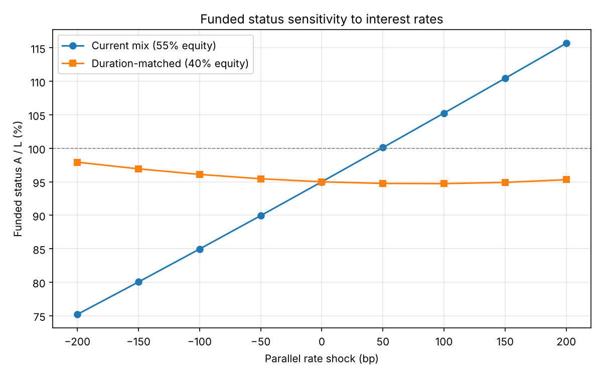
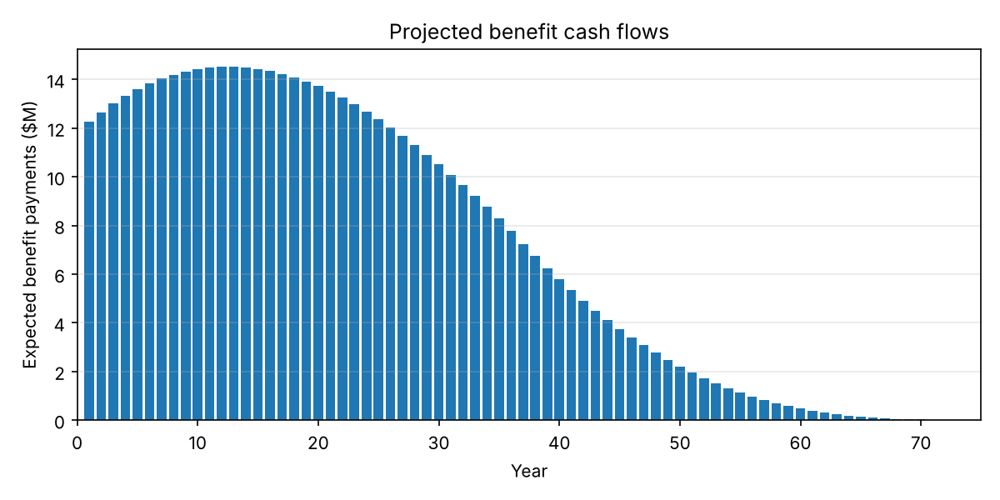

# Pension Liability Model: Funded Status vs Interest Rates

A small Python model of a defined benefit pension plan. It projects benefit payments, values the liability, and shows how the plan's funded status moves when interest rates shift, first with a typical asset mix and then with assets matched to the liability's duration.

I built it to understand asset-liability management (ALM) beyond the formulas: why a pension plan can lose ground when rates *fall* even if its assets go up, and what "matching" actually fixes.



## What the model does

1. **Plan members.** A made-up plan with 700 active members (ages 30 to 64) and 492 retirees (ages 65 to 94). Actives have accrued a pension of 1.5% x years of service x salary, payable from 65. Retirees receive $24,000 a year.
2. **Expected cash flows.** Each payment is weighted by the probability the member is still alive, using the SOA Standard Ultimate Life Table (Makeham's law):

$$
\mu_x = A + B c^x, \qquad A = 0.00022, \quad B = 2.7 \times 10^{-6}, \quad c = 1.124
$$

$$
{}_tp_x = \exp\left(-At - \frac{B c^x (c^t - 1)}{\ln c}\right)
$$

3. **Liability value.** Present value of expected payments at a flat rate $y = 4.5\%$:

$$
L(y) = \sum_{t \ge 1} \frac{CF_t}{(1+y)^t}
$$

4. **Duration and convexity.** Computed numerically by bumping the rate up and down by 1 bp:

$$
D = \frac{L(y - \Delta y) - L(y + \Delta y)}{2 L(y) \Delta y}, \qquad
C = \frac{L(y - \Delta y) + L(y + \Delta y) - 2L(y)}{L(y) \Delta y^2}
$$

5. **Two asset portfolios,** both starting at 95% funded:
   - *Current mix:* 55% equity, 30% 5-year bonds, 15% 20-year bonds.
   - *Duration-matched:* 40% equity, with the bond sleeve split between a 5-year bond and a 30-year strip so that the assets' dollar duration equals the liability's:

$$
A_{FI} \left(w D_{long} + (1-w) D_{short}\right) = L \cdot D_L
$$

6. **Rate shocks.** Parallel shifts from -200 bp to +200 bp, recording assets, liability and funded ratio $A/L$ at each step.

## Results

| | Value |
|---|---|
| Liability (PV at 4.5%) | $243.2M |
| Liability duration | 13.98 |
| Liability convexity | 317.3 |
| Liability DV01 (1 bp fall) | $340,291 |
| Hedge ratio, current mix | 22% |
| Hedge ratio, duration-matched | 100% (83% in 30-year strip) |

| Shock (bp) | Current mix | Duration-matched |
|---:|---:|---:|
| -200 | 75.2% | 97.9% |
| -100 | 85.0% | 96.1% |
| 0 | 95.0% | 95.0% |
| +100 | 105.3% | 94.7% |
| +200 | 115.7% | 95.3% |

Full output: [`summary.txt`](summary.txt) and [`shock_results.csv`](shock_results.csv).

## What I took from it

- **Falling rates hurt an unmatched plan.** With the current mix, a 200 bp drop takes the plan from 95% to 75% funded. The liability (duration about 14) rises much faster than assets that are mostly equity and short bonds. Only 22% of the rate risk is hedged.
- **Matching dollar duration protects the surplus, not the ratio.** In the matched portfolio, the deficit stays between about $7M and $12M across all shocks, compared with a swing from -$82M to +$30M for the current mix, so the funded ratio barely moves. To lock the *ratio* exactly you would match durations ($D_A = D_L$) instead of dollar durations.
- **Getting to 100% hedged takes long bonds.** With 40% in equity, the bond sleeve needs a duration of about 24.5, which a 30-year coupon bond (duration about 16) can't reach. That is why plans use strips, long bonds or swaps.
- **Duration alone isn't enough for big moves.** For a -200 bp shock, duration predicts +28.0% on the liability, the exact change is +35.8%, and adding convexity gets to +34.3%. The matched portfolio's small gains at both extremes come from the strip having more convexity than the liability.



## Simplifications

- Flat yield curve and parallel shocks only. Real liabilities are discounted on a curve (often AA corporate) and curves twist.
- Same rate for assets and liabilities, so there is no credit spread risk.
- No inflation indexation, salary growth or new entrants.
- Equity value is assumed not to react to rates.
- Annual payments at year end.

## Run it

```bash
pip install -r requirements.txt
python run_analysis.py      # writes fresh results and charts to output/
python -m pytest            # 7 sanity checks
```

## Files

```
pension_model.py           mortality, cash flows, PV, duration, bonds, portfolios, shocks
run_analysis.py            runs the model, prints the summary, saves charts
test_model.py              checks (e.g. strip duration = T / (1 + y), matched DV01 = liability DV01)
funded_status_shocks.png   chart: funded status vs rate shock
cash_flows.png             chart: projected benefit payments
shock_results.csv          full results table
summary.txt                console output from the last run
```

## Next steps

- Discount on a real yield curve (Bank of Canada zero-coupon curve) and test non-parallel shocks.
- Add inflation indexation to benefits.
- Replace fixed shocks with simulated rate paths to get a distribution of funded status.
